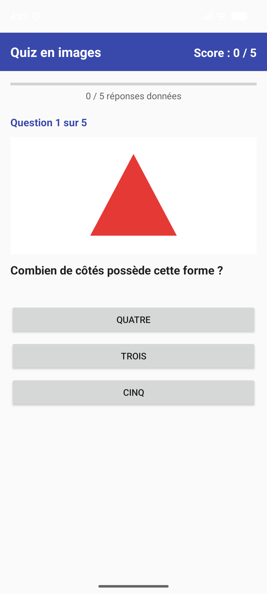
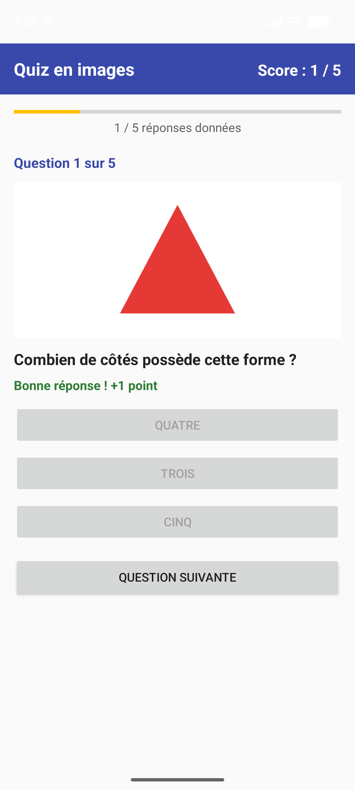
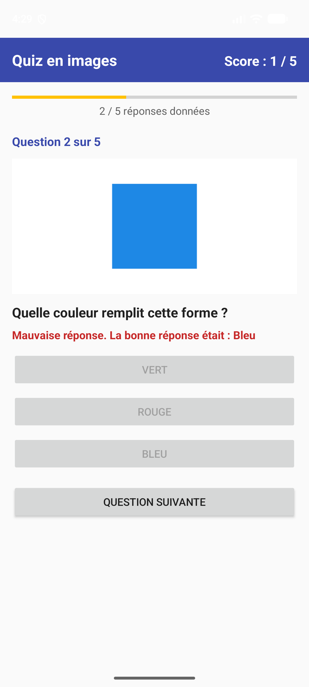
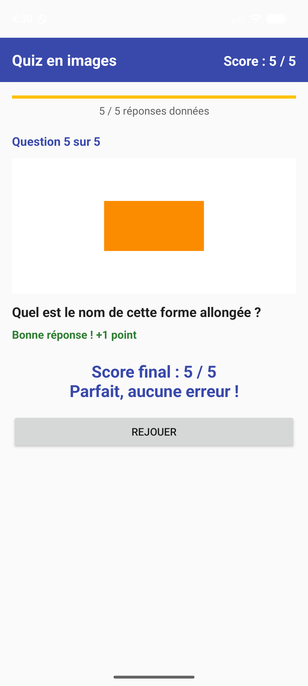

# Captures d’écran

Les quatre captures ci-dessous ont été réalisées sur l’émulateur Android (Pixel_8, écran 1080 × 2400)
avec l’APK compilé depuis ce dépôt.

| Fichier | Situation capturée |
| --- | --- |
| `01_question.png` | Question 1 avec son image, ses trois boutons, le score 0/5 en haut à droite et la progression 0/5. |
| `02_bonne_reponse.png` | Bonne réponse à la question 1 : message « Bonne réponse ! +1 point », score 1/5, progression 1/5. |
| `03_mauvaise_reponse.png` | Mauvaise réponse à la question 2 : message indiquant la bonne réponse, score inchangé (1/5), progression 2/5. |
| `04_resultat_final.png` | Écran final après cinq bonnes réponses : score 5/5, progression 5/5 et bouton **Rejouer**. |






## Régénérer les captures

1. Lancer l’application sur un émulateur ou un appareil connecté en USB.
2. Avec Android Studio : bouton **Screenshot** de la barre d’appareil.
3. En ligne de commande :

```powershell
adb shell screencap -p /sdcard/quiz_capture.png
adb pull /sdcard/quiz_capture.png captures\01_question.png
```

4. Répéter pour les quatre situations, puis vérifier que les images sont lisibles dans le dépôt GitHub.

> Important : ne pas exclure ce dossier dans `.gitignore` ; les captures font partie du travail à rendre.
